# Air-quality exploratory data analysis

## Scope and reproducibility

This analysis covers distributions, pollutant relationships, correlations, and calendar/time patterns for both datasets. All analytical figures and correlations use exactly the rows in the existing training exports. The four training X/Y files are checked against reconstructed rows before plotting. Test X/Y files are never loaded. Full-source counts in `dataset_overview.csv` describe cleaning only; they are not used to select features or models.

The analysis preserves existing preprocessing and does not overwrite `processed/`. It verifies the new 1–3-hour PM2.5 lags, rolling 24-hour mean (at least 12 observations), cyclical hour/month features, and exported training metadata. A copy of the metadata is saved under `eda/tables/` for traceability. This EDA script does not train models or select a final feature subset; separate baseline and neural-network notebooks now provide modeling results.

Run `python3 term_project/eda_analysis.py` from the repository root. The script resolves paths relative to itself, so it also works from other directories. Figures are PNGs and all statistics are exported as CSVs.

## Interpretation limits

- Current pollutant correlations describe association, not causation. Pooled correlations can reflect location differences; compare the exported within-location-centered correlations and Spearman correlations.
- IQR flags identify unusual observations for inspection; they do not establish sensor error. No additional outlier filtering or clipping is performed.
- Calendar averages use retained complete cases and are observation-weighted. Missingness and target availability can alter their composition. Daily/monthly counts are exported alongside means.
- Global and Beijing differ in period, locations, available predictors, and sampling. EDA does not isolate a geographic cause for differences or demonstrate transfer to unseen locations.
- PM2.5 is labeled in µg/m³ following the project definition (and UCI metadata for Beijing). Other pollutant axes retain source values; confirm Global source units before making cross-dataset concentration comparisons.
- The separate linear-regression feature-set comparison uses chronological validation within training, with a 24-hour gap. See the feature-selection results linked in the project README.

## Global cities

The verified training sample contains **39,102 rows**, from 2023-01-01 11:00:00+00:00 through 2023-09-29 23:00:00+00:00.

- Current PM2.5: mean **19.08**, median **14.10**, maximum **143.40 µg/m³**; skewness **1.82**.
- Highest location mean: **Dubai (41.66 µg/m³)**. Lowest: **Brasilia (7.27 µg/m³)**. These describe the retained training sample.
- Strongest pooled current-PM2.5 correlation among the other pollutants: **PM10 (Pearson r = 0.891)**.
- Current PM2.5 correlation with future PM2.5: **1h: 0.980**; **6h: 0.816**; **24h: 0.765**. These are correlations, not predictive performance metrics.
- Across retained observations, the highest pooled month-of-year mean is **August (20.53 µg/m³)** and the lowest is **January (16.62 µg/m³)**. Per-location profiles and observation counts are exported.

Only January–September are available for training-period calendar EDA. This cannot establish a complete annual seasonal cycle or its repeatability. Global hours are UTC, not local city hours; do not interpret a shared UTC peak as a shared rush-hour effect.

### Pollutant distributions

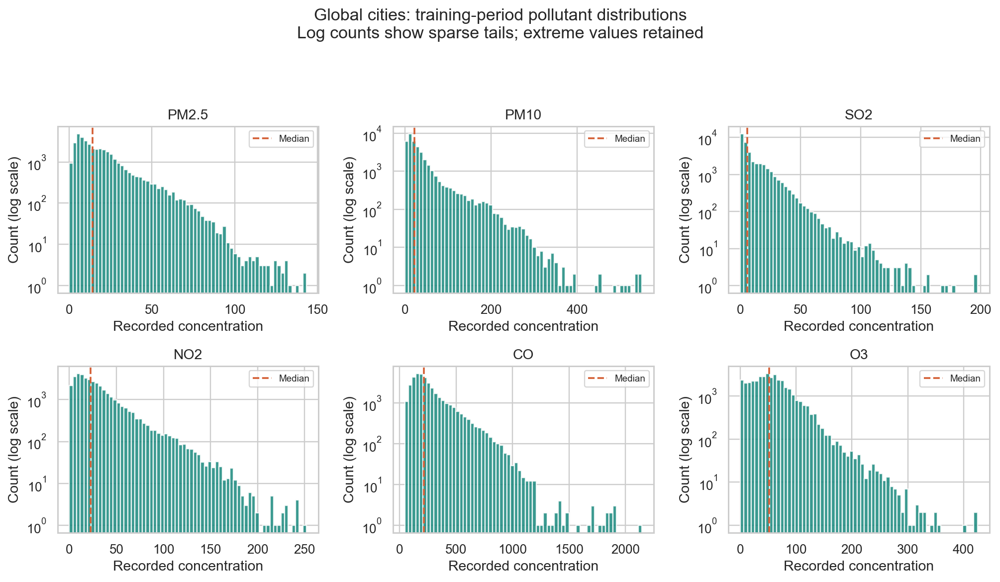

### PM2.5 by location

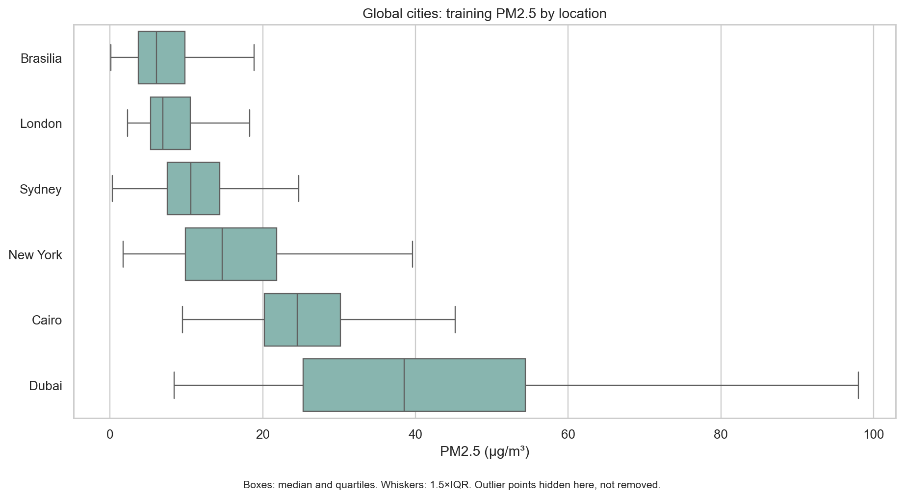

### Current-measurement correlations

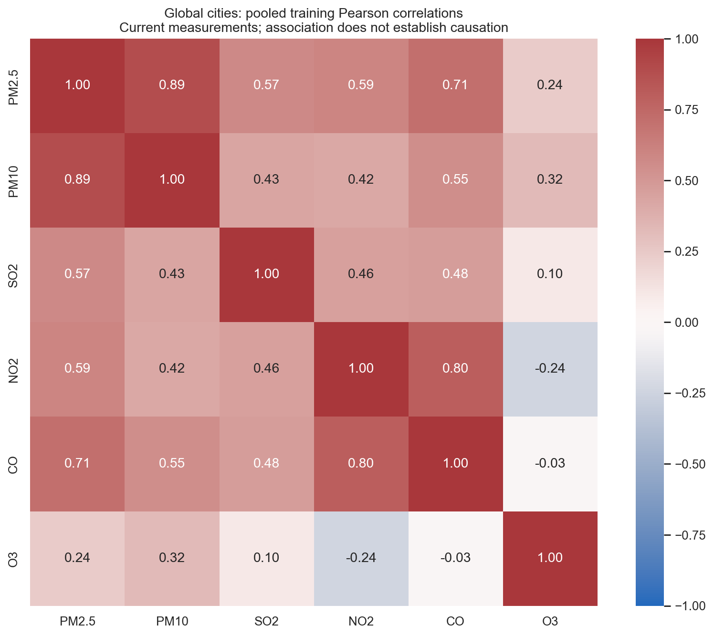

### Correlations with future PM2.5

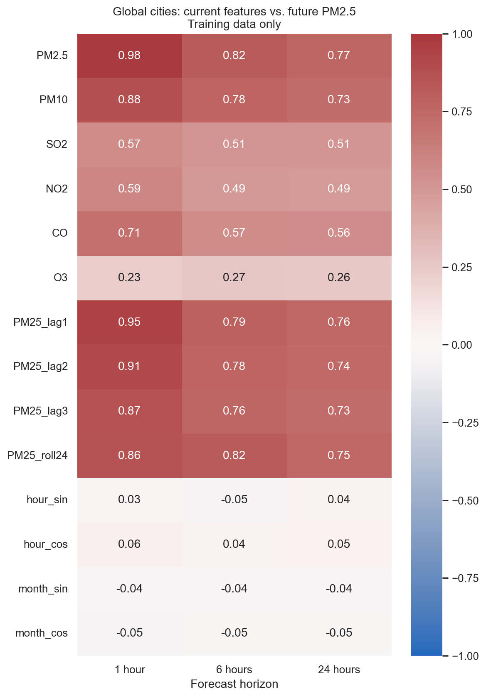

### Pollutant relationships

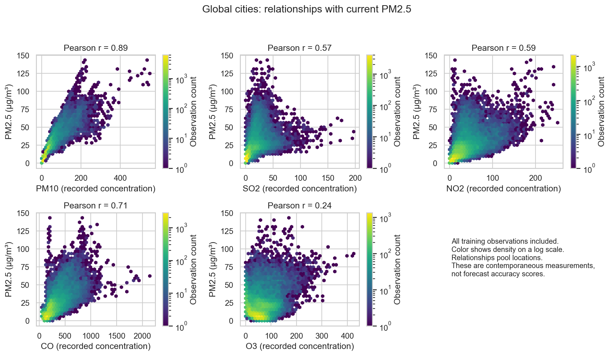

### Time trends and observation counts

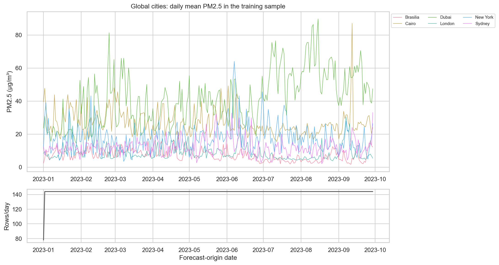

### Monthly and hourly patterns

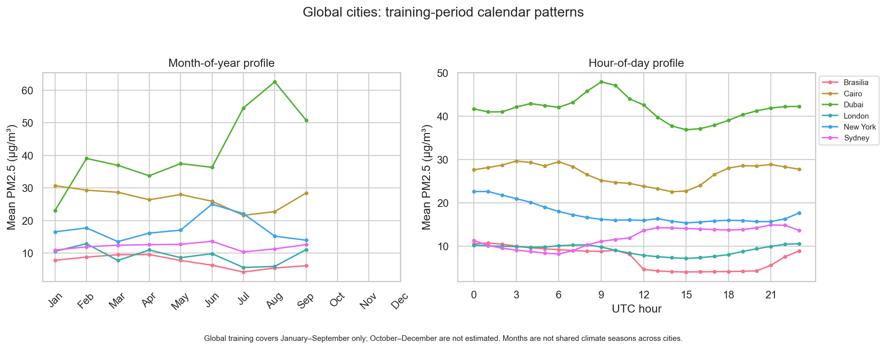

## Beijing stations

The verified training sample contains **236,547 rows**, from 2013-03-01 11:00:00 through 2016-02-28 23:00:00.

- Current PM2.5: mean **79.64**, median **56.00**, maximum **844.00 µg/m³**; skewness **1.82**.
- Highest location mean: **Nongzhanguan (84.47 µg/m³)**. Lowest: **Dingling (67.44 µg/m³)**. These describe the retained training sample.
- Strongest pooled current-PM2.5 correlation among the other pollutants: **PM10 (Pearson r = 0.877)**.
- Current PM2.5 correlation with future PM2.5: **1h: 0.969**; **6h: 0.764**; **24h: 0.409**. These are correlations, not predictive performance metrics.
- Across retained observations, the highest pooled month-of-year mean is **March (96.96 µg/m³)** and the lowest is **August (56.70 µg/m³)**. Per-location profiles and observation counts are exported.

Month-of-year averages pool multiple training years. They describe calendar variation rather than proving a stable seasonal mechanism. The original complete-case filtering is preserved, including its requirement for complete future rows when constructing targets.

### Pollutant distributions

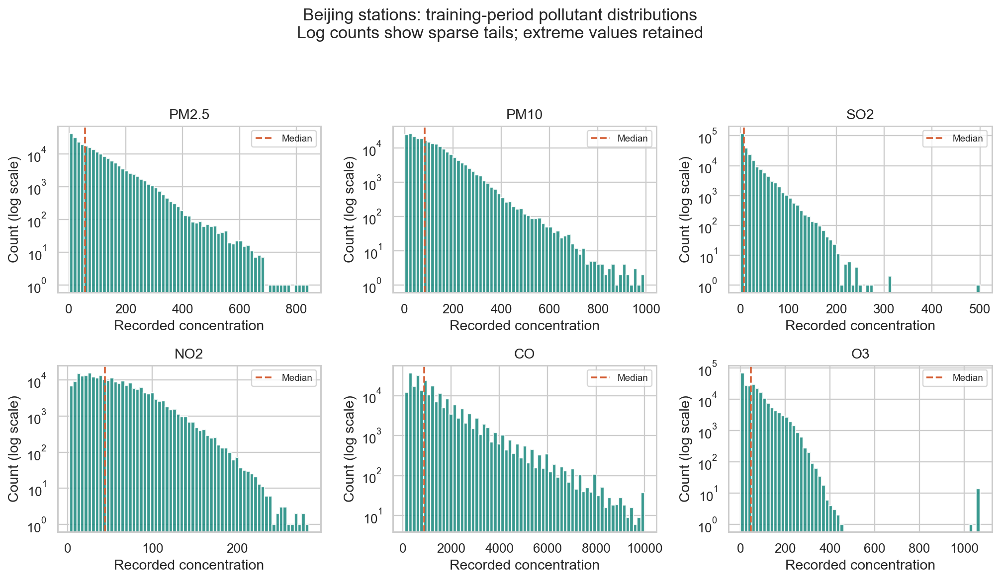

### PM2.5 by location

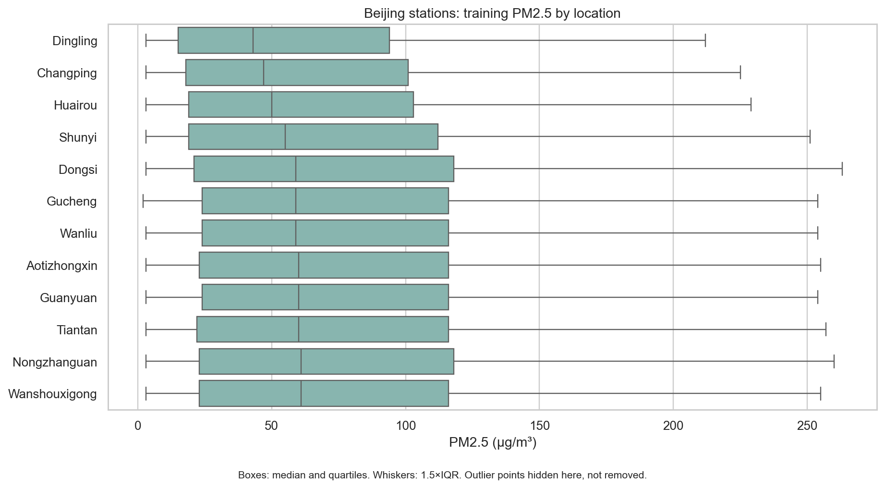

### Current-measurement correlations

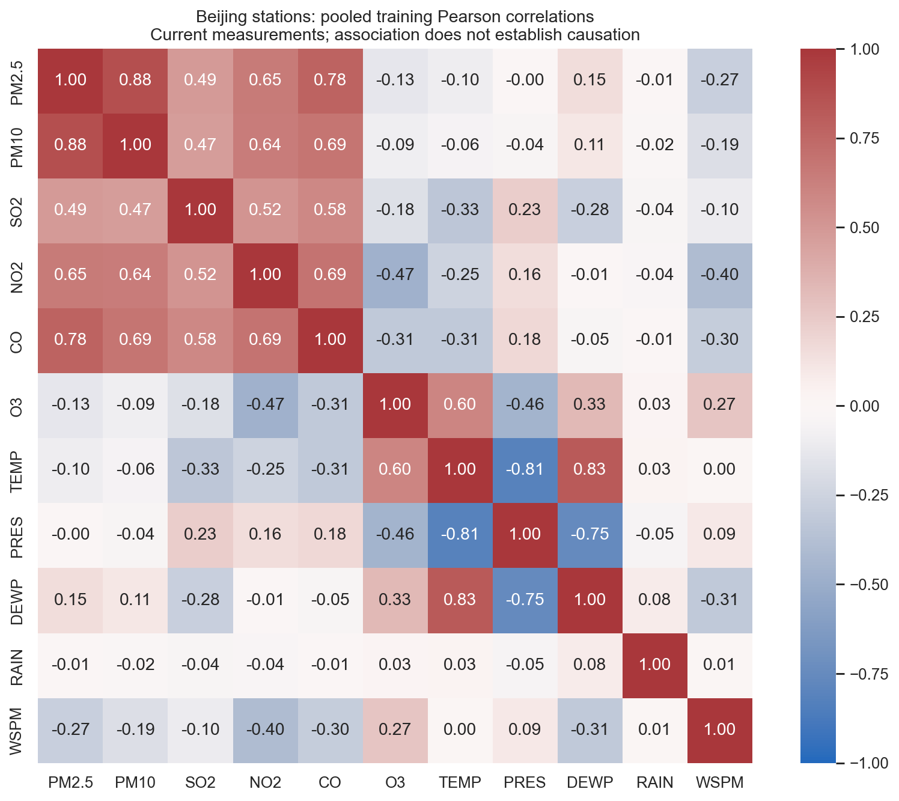

### Correlations with future PM2.5

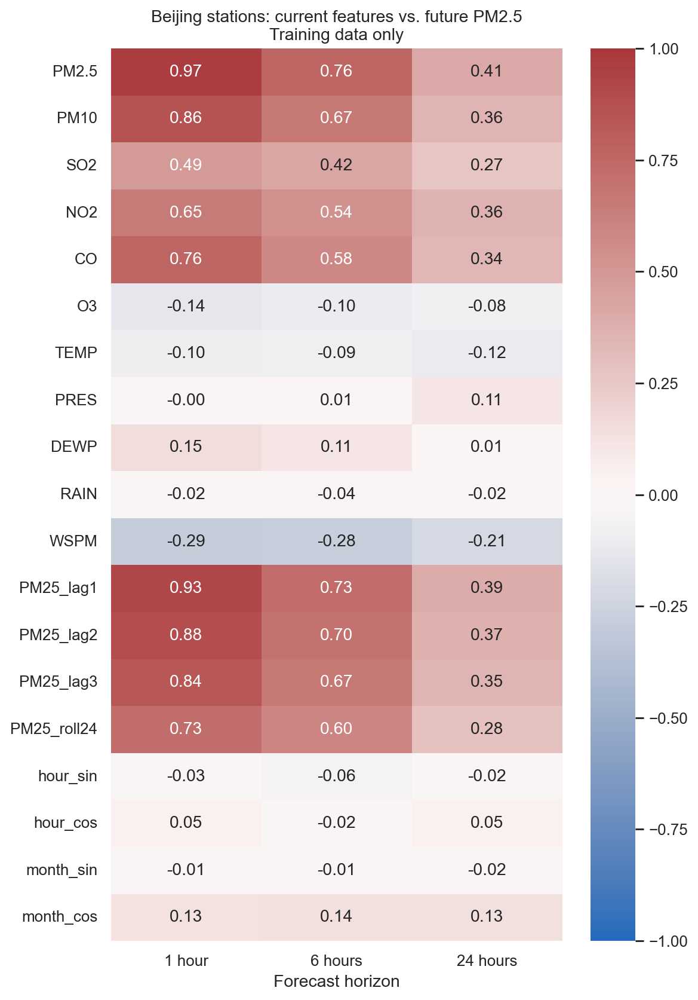

### Pollutant relationships

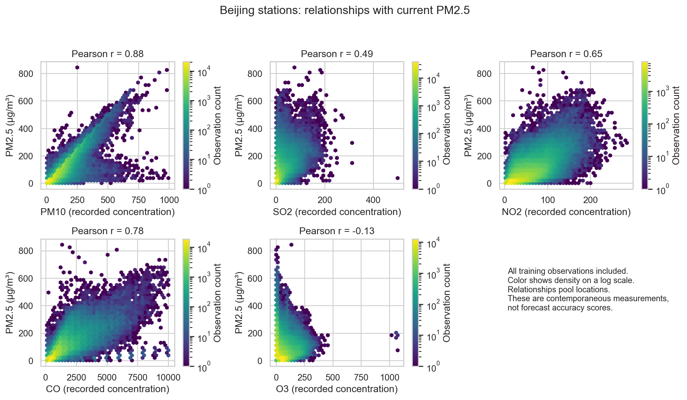

### Time trends and observation counts

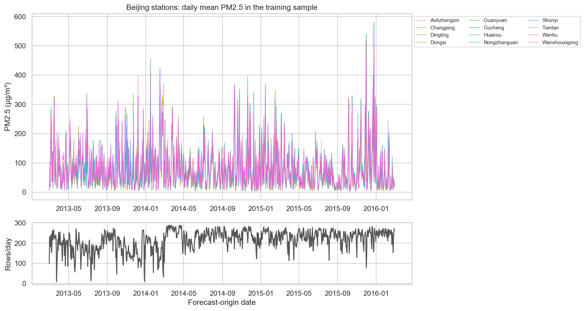

### Monthly and hourly patterns

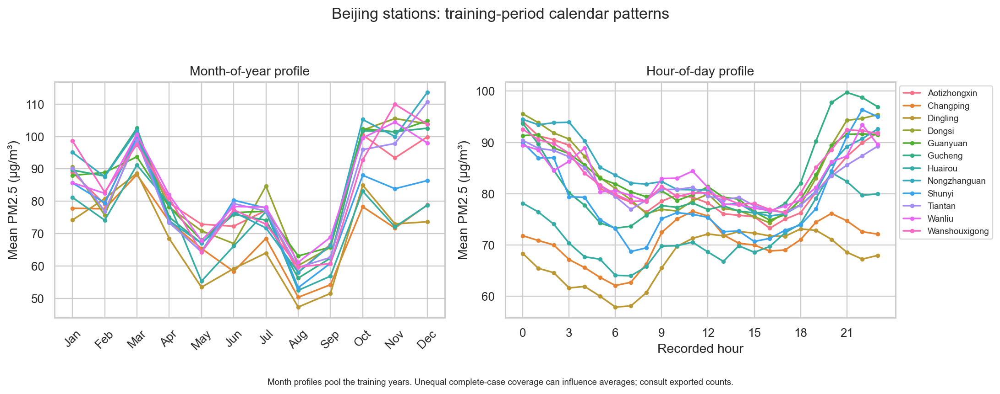

## Implications for modeling

1. Compare the implemented mean and persistence baselines with learned models at each horizon. Use matching data versions and test rows; see `../INTEGRATION_REVIEW.md` for the current result audit.
2. Examine correlated predictors jointly before interpreting coefficients; marginal correlation alone is not feature selection.
3. Evaluate transformation choices on chronological validation data. Global contains zero PM2.5 values, so a plain log transform is not defined everywhere.
4. Report errors by city/station as well as overall. Keep chronological validation distinct from any experiment intended to test unseen locations.

## Dataset references

- [Global Air Quality (2023), six cities — Kaggle](https://www.kaggle.com/datasets/youssefelebiary/global-air-quality-2023-6-cities)
- [Beijing Multi-Site Air Quality — UCI](https://archive.ics.uci.edu/dataset/501/beijing+multi+site+air+quality+data)
